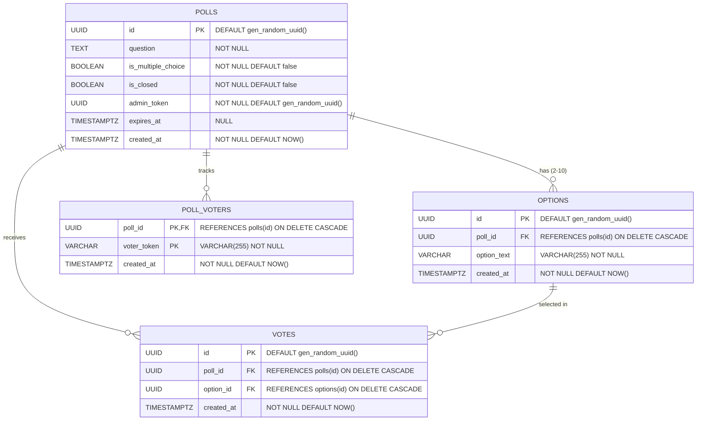

# QuickPoll Entity Relationship Diagram

This document describes the database tables and constraints used in QuickPoll.

## Key Constraints & Guarantees
1. **Duplicate Ballot Prevention**:
   - `poll_voters` has a compound primary key `(poll_id, voter_token)`.
   - Any duplicate submission attempt triggers PostgreSQL error code `23505` (`unique_violation`), which the API catches and translates to HTTP `409 Conflict`.
2. **Cascading Deletions**:
   - Deleting a poll cascades to its options, voter tracking records, and cast votes (`ON DELETE CASCADE`).
3. **Optimized Indexing**:
   - `idx_options_poll_id` on `options(poll_id)`
   - `idx_votes_poll_id` on `votes(poll_id)`
   - `idx_votes_option_id` on `votes(option_id)`
